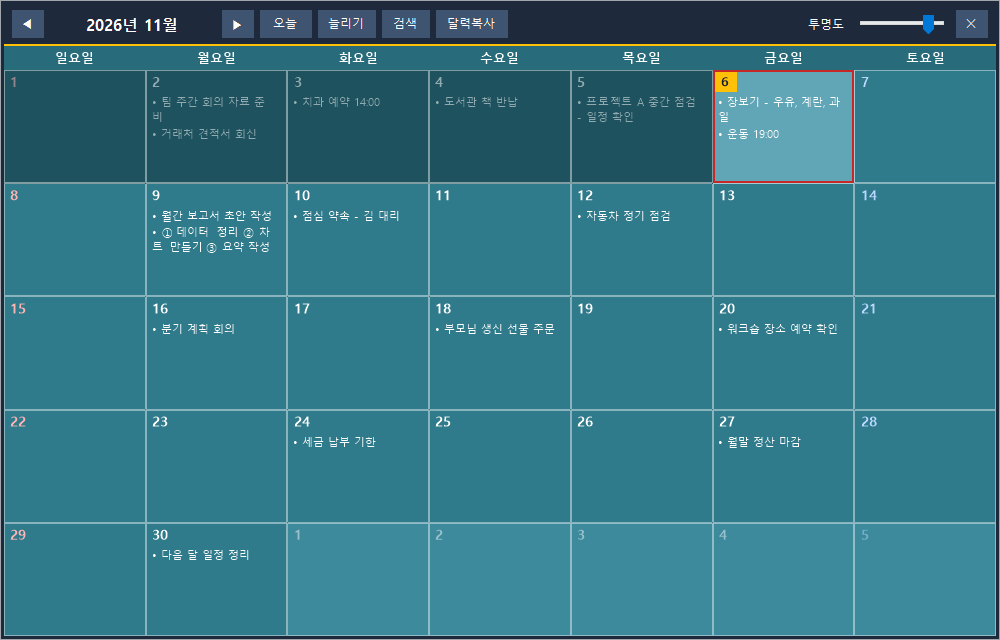

# 메모 달력 (memo-calendar)

바탕화면에 떠 있는 **메모 달력**입니다. 날짜 칸을 눌러 **한 줄에 메모 하나**씩 그냥 적으면 끝입니다. 형식도, 분류도, 자동화도 없습니다.



메모는 평범한 `memos.json` 파일 하나에 저장됩니다. OneDrive 폴더에 두면 여러 PC가 같은 달력을 보고, **Claude 스킬**을 붙이면 "지난주 메모 요약해줘" 같은 말로 PC와 휴대폰에서 메모를 읽고 고칠 수 있습니다. 앱 안에 AI는 없습니다.

## 특징

- **자유 입력:** 날짜 칸을 클릭하고 한 줄에 메모 하나. 입력창은 `Ctrl+Enter`로 저장합니다.
- **가볍습니다:** `src/MemoCalendar.cs` 한 파일, .NET Framework 4(Windows에 기본 포함). 설치할 것이 없고 약 40MB 메모리를 씁니다.
- **바탕화면 위젯 느낌:** 투명도 슬라이더, 끌어서 이동, 가장자리로 크기 조절, 트레이 상주, 윈도우 시작 시 자동 실행.
- **오늘과 지난 날:** 오늘은 노란 배지와 빨간 테두리, 이번 달의 지난 날은 어둡게 가라앉습니다.
- **검색:** 띄어쓰기로 나눈 단어가 모두 들어간 메모를 찾고, 결과를 열면 그 달로 이동합니다.
- **달력복사:** 위쪽 바의 "달력복사" 버튼을 누르면 날짜 칸을 불투명한 그림으로 클립보드에 복사합니다. 메신저나 문서에 `Ctrl+V`로 붙이면 됩니다. 파일은 만들지 않습니다.
- **안전한 저장:** 임시 파일에 쓰고 검증한 뒤 교체하는 방식으로 저장하고, `backup` 폴더에 자동 백업을 쌓습니다.
- **트레이 툴팁:** `메모 달력 · 마지막 갱신 HH:mm:ss`. 다른 기기에서 고친 내용이 언제 반영됐는지 알 수 있습니다.

## 설치와 실행 (Windows 10/11)

```bat
build.bat
MemoCalendar.exe
```

`build.bat`은 Windows에 이미 있는 `csc.exe`를 부릅니다. Visual Studio나 SDK가 필요 없습니다. 직접 하려면:

```bat
%WINDIR%\Microsoft.NET\Framework64\v4.0.30319\csc.exe /nologo /target:winexe /optimize+ /codepage:65001 /out:MemoCalendar.exe /r:System.dll,System.Core.dll,System.Drawing.dll,System.Windows.Forms.dll,System.Web.Extensions.dll src\MemoCalendar.cs
```

## 사용법

| 하고 싶은 일 | 방법 |
|---|---|
| 메모 쓰기 | 날짜 칸 클릭 → 한 줄에 메모 하나 → `Ctrl+Enter` |
| 달 이동 | ◀ ▶ 버튼, 마우스 휠, `PageUp`/`PageDown` |
| 오늘로 | "오늘" 버튼 또는 `Home` |
| 검색 | "검색" 버튼 또는 `Ctrl+F` |
| 달력 그림 복사 | "달력복사" 버튼 |
| 높이 늘리기 | "늘리기" 버튼 |
| 보이기/숨기기, 저장 폴더, 자동 실행, 종료 | 트레이 아이콘 우클릭 |

공휴일은 `src/MemoCalendar.cs`의 `Hol`에 **2026년분만** 들어 있습니다. 다른 해는 직접 추가해야 합니다.

## 데이터

기본 저장 위치는 `%OneDriveCommercial%\memo-calendar\memos.json`입니다. 없으면 개인 OneDrive, 그것도 없으면 문서 폴더를 쓰고, 트레이 메뉴에서 폴더를 바꿀 수 있습니다. 형식은 [docs/design.md](docs/design.md)를 보세요.

## Claude 스킬

`skill/memo-calendar/SKILL.md`는 Claude가 `memos.json`을 읽고 고치게 하는 스킬입니다. 요약은 바로 하고, 추가·수정·삭제는 변경 목록을 보여 주고 확인을 받은 뒤 백업을 만들고 저장합니다. 설치와 사용법은 [docs/skill.md](docs/skill.md)에 있습니다.

## 문서

- [docs/design.md](docs/design.md): 설계 원칙, 데이터 형식, 동기화와 백업
- [docs/skill.md](docs/skill.md): 스킬 설치와 사용, 휴대폰에서 쓰기

## 라이선스

MIT
